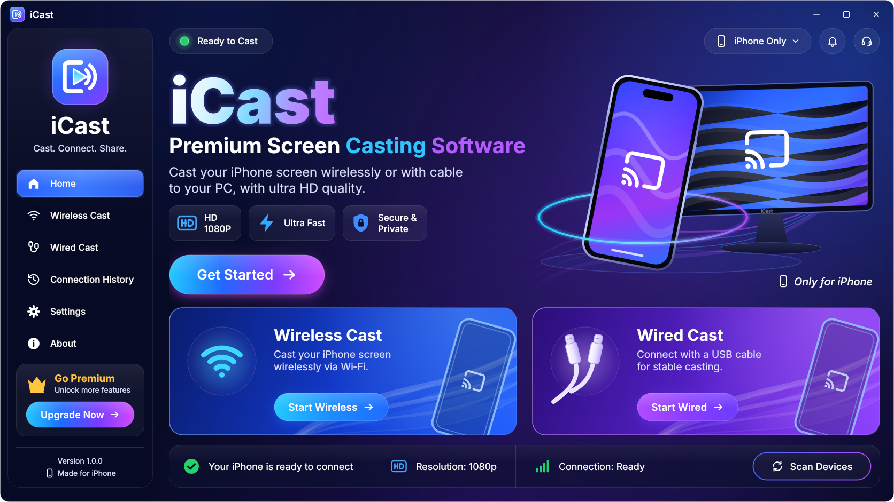

# iCast — iPhone Screen Cast



Mirror your iPhone screen to a Linux computer in two ways:

| Mode | How it connects | Engine | Best for |
|---|---|---|---|
| **Wireless · AirPlay** | Same Wi‑Fi. On iPhone: *Control Center → Screen Mirroring → iCast* | [UxPlay](https://github.com/FDH2/UxPlay) | No cable, presentations, TV-style use |
| **Wired · USB** | Lightning / USB‑C cable | [qvh](https://github.com/danielpaulus/quicktime_video_hack) + libimobiledevice | Lowest delay, best picture, no Wi‑Fi needed |

iCast is the control app: a premium neon/glass desktop UI (Home, Wireless Cast, Wired Cast,
Connection History, Settings, About) plus a CLI. It finds your devices,
builds the right engine command, watches the engine's state
(Starting → Waiting → **Live**), shows a live timer, records over USB to MP4,
and runs health checks.

## Install (Ubuntu / Debian / Mint)

```bash
cd i_cast
./scripts/install.sh
```

The script installs UxPlay, Avahi, usbmuxd, libimobiledevice, GStreamer and ffmpeg, builds `qvh`,
adds a udev rule for iPhone USB access, opens firewall ports if `ufw` is on, and installs the `icast`
command and its launcher.

Check everything is ready:

```bash
icast doctor
```

## Use

**Desktop app:** run `icast` (or open *iCast* from the app menu).

**Command line:**

```bash
icast wireless --name "Living Room" --resolution 1920x1080 --fps 60 --pin 1234
icast wired                 # fullscreen, ultra-low-latency USB mirroring (Esc to stop)
icast wired --smooth        # steadier pacing for slower PCs
icast wired --window        # classic small window
icast wired --record        # record to ~/Videos/iCast/*.mp4
icast devices               # list USB iPhones
icast pair <udid>           # show the "Trust This Computer" prompt
```

### বাংলায় দ্রুত গাইড
- **Wireless:** iPhone আর কম্পিউটার একই Wi‑Fi তে রাখুন → iCast এ *Start casting* চাপুন → iPhone এ Control Center → Screen Mirroring → **iCast** সিলেক্ট করুন।
- **Wired:** ক্যাবল দিয়ে iPhone লাগান → ফোন unlock করে **Trust** চাপুন → *Wired · USB* ট্যাবে ফোন দেখাবে → *Start casting*।

## Viewer keys (wired and wireless)

| Key | Action |
|---|---|
| **Esc** | leave fullscreen → small window (casting keeps running) |
| **F** / **Enter** / double-click | fullscreen again |
| **Q** / close the window | stop casting |

The viewer is **mpv** (low-latency profile, iCast's own key bindings); ffplay is used if mpv is not
installed (there Esc stops casting).

## Fullscreen in any orientation (games, video, landscape apps)

AirPlay keeps the picture's **height** and changes its **width** when the iPhone rotates. UxPlay's own
window keeps the size of the first (portrait) frame, so landscape games ended up small in the middle.
iCast now asks UxPlay to forward the video (`-vrtp`, UxPlay ≥ 1.73) to iCast's fullscreen viewer,
which re-fits every frame to the screen: portrait fills the height, landscape fills the width —
automatically, wired and wireless. Resolution **Auto** requests exactly this monitor's size.

**Frame rate:** iCast tells the iPhone the display runs at 120 Hz and allows up to 120 fps
(`-s WxH@120 -fps 120`). The iPhone decides the final rate (many models send at most 60 fps over
AirPlay); iCast shows every frame it receives immediately.

## Wired engines

| Engine | How | Notes |
|---|---|---|
| **AirPlay over USB cable** (default) | iPhone *Personal Hotspot → Allow Others to Join*, cable connected → the iPhone creates a USB network link (ipheth, 172.20.10.x) and Screen Mirroring runs over the cable | Apple's own protocol: works on every iOS version, no Wi‑Fi needed, opens fullscreen |
| QuickTime capture (qvh) — experimental | Reverse-engineered USB screen-capture protocol | qvh is unmaintained since 2023; on very new iOS versions the iPhone may never start the stream (“waiting for ping”) |

```bash
icast wired                  # uses the engine chosen in the app (default: AirPlay over USB)
icast wired --engine qvh     # QuickTime capture
```

## Wired fullscreen (qvh engine): how it stays fast

`Start Wired` opens **one borderless fullscreen window** that fills the monitor iCast is on, with
the phone picture centered and its shape kept.

- qvh receives Apple's screen stream over USB and hands the phone's **H.264 untouched** (no
  re-encode) to a local socket.
- `ffplay` decodes it with no input buffer (`nobuffer`, `low_delay`), shows the newest frame
  (`setpts=0`) and drops any frame that is already stale, so the delay never builds up.
- Sound plays through GStreamer with a 40 ms buffer, so it stays in sync with the picture.
- Keys: **Esc / q** stop · **F** or double-click toggles fullscreen.
- Measured with a 60 fps test stream: the newest frame stayed on screen with no growing delay. Pick
  *Smooth* latency in Wired Cast (or `--smooth`) on slower PCs.

### Why wired needs the patched qvh + USB helper
Linux only lets qvh switch the iPhone into its screen-capture USB configuration while nothing else
holds the iPhone, but stock qvh refuses to run unless usbmuxd (which *does* hold it) is reachable.
iCast resolves this per session:

1. `idevicepair validate` — trusted? (usbmuxd still running)
2. `python -m icast.core.usbcap activate` — iCast's own activation: one usbfs control request
   (0x40/0x52, wIndex 2, exactly what qvh/QuickTime send), then it watches `/sys` until the iPhone
   re-connects with the vendor/0x2A capture interface — 15 s limit, readable progress. (qvh's
   `activate` retries forever if the re-connect is missed.)
3. `icast-usb prepare` — pause usbmuxd, release the iPhone's interfaces
4. `qvh gstreamer` with `QVH_SKIP_PAIR_CHECK=1` — capture mode is already on, so it just captures
5. cleanup (always, also on quit): `qvh deactivate` straight over USB → `icast-usb restore`

## Troubleshooting

| Problem | Fix |
|---|---|
| Wireless: “DNSServiceRegister … NameConflict” | Fixed automatically: iCast stops leftover receivers before starting and, if the name is still taken, restarts once with a fresh device ID |
| iCast doesn't appear in Screen Mirroring | `sudo systemctl enable --now avahi-daemon`; same Wi‑Fi; disable "client isolation" on the router; turn on *Fixed ports* and allow 7100‑7102 + 5353/udp |
| Choppy wireless video | Use 5 GHz Wi‑Fi, try 1280×720 or 30 fps, keep *Low‑latency mode* on |
| iPhone not listed under USB | Unlock the phone, tap *Trust*, run `sudo systemctl restart usbmuxd`, try another cable |
| "Not trusted" | Click *Trust this computer* in iCast and accept on the iPhone |
| No sound | Wireless: set *Audio output* to `pulsesink` or `pipewiresink`. Wired: check *Play iPhone sound* |
| Wired: stuck on “Preparing iPhone for capture…” | iCast now gives up after 25 s with advice. Unplug and re-plug the iPhone, unlock it, Start Wired again. The log contains qvh's detailed (`-v`) output — send it if it repeats |
| Wired: “device not found, is it still connected? … /var/run/usbmuxd” | Old qvh. Run `scripts/install.sh` — it builds the pinned, patched qvh (`scripts/build-qvh.sh`) |
| Wired: “interface claimed by usbfs while 'qvh' sets config” (dmesg) | usbmuxd is holding the iPhone. Run `scripts/install.sh` (installs the USB helper), re-plug, Start Wired |
| Wired: no iPhone listed, but it is plugged in (`idevice_id -l` empty) | The iPhone was left in capture mode by an interrupted session. iCast detects this at startup / Start Wired / Reset USB and does a **software re-plug** (`/sys/…/authorized` 0→1) automatically. Manual: unplug and re-plug the cable |
| Wired: no iPhone listed after a crash | iCast restores usbmuxd at startup; or run `sudo systemctl unmask --runtime usbmuxd && sudo systemctl start usbmuxd` |
| Wired: “No permission to use the iPhone over USB” | Run `scripts/install.sh` again, then unplug and re-plug the iPhone |
| Wired: “didn't switch into capture mode” / “Could not retrieve config” | Press **Reset USB** (or `icast reset-usb`), re-plug, unlock, Start Wired. iCast pauses usbmuxd and the iPhone tethering driver while casting, because Linux won't switch the iPhone's USB mode while they hold it |
| Wired picture stutters | Choose *Smooth* latency in Wired Cast, or close heavy apps |

Settings are saved in `~/.config/icast/settings.json`.

## Development

```bash
python3 -m venv .venv && . .venv/bin/activate
pip install -e ".[dev]"
pytest
python -m icast
```

Code layout:

```
icast/
  core/       config (JSON settings), deps (doctor), devices (USB iPhones), process (engine supervisor)
  backends/   wireless.py (UxPlay), wired.py (qvh)
  core/history.py  connection history (JSON)
  gui/        theme, icons (vector SVG set), widgets (custom-painted UI), controller, main_window
  cli.py      command-line interface
```

## Licensing note
iCast is MIT. It launches UxPlay (GPL‑3.0) and qvh (MIT) as separate programs and does not bundle them.
AirPlay and iPhone are trademarks of Apple Inc.; iCast is not affiliated with Apple.
